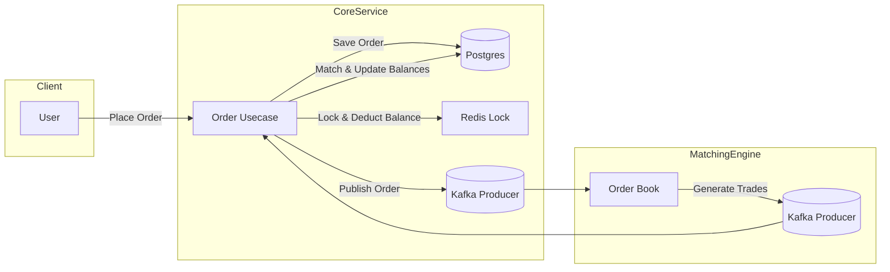

# 🚀 Crypto Exchange Service
A modular crypto exchange service written in **Go**, designed with separation of concerns:

* **Core Service** → Handles order processing, validation, wallet balance updates, and publishing orders to Kafka.
* **Matching Engine** → Maintains in-memory order books per pair, matches buy/sell orders, and emits trades for settlement.

The system leverages **PostgreSQL**, **Redis (with Redsync distributed locks)**, and **Kafka** to ensure consistency, high throughput, and fault tolerance.

---

## 📂 Project Structure

```plaintext
core-engine/
│── internal/app/domains/usecase/  # Core business logic (order processing, matching settlement)
│── internal/app/domains/          # DTOs, models, repositories
│── pkg/                           # Shared packages (gorm, jwt, kafka, errors, logging)
│── ...
matching-engine/
│── internal/app/domains/usecase/  # Matching engine (order book & matching logic)
│── internal/app/model/            # Trade & order models
│── pkg/                           # Kafka, Redis, utils
```

---

## ⚙️ Core Service (Order Processing)

Handles:

* ✅ **Authentication & Authorization** using JWT
* ✅ **Balance Updates** with Redis distributed locks (`redsync`)
* ✅ **Transactional Safety** with PostgreSQL + GORM
* ✅ **Publishing Orders** to Kafka (topic per trading pair)
* ✅ **Settlement** when trades are matched

**Flow:**

1. User places an order → Verify user & account → Lock wallet → Deduct funds → Save order → Publish to Kafka
2. Matching Engine sends trades → Lock wallets → Update balances → Save match order

---

## ⚙️ Matching Engine (Order Book)

* Maintains **in-memory order books** (`BuyOrders`, `SellOrders`) per crypto pair
* Matches incoming limit orders against opposite side
* Supports:

  * Full fill
  * Partial fill (remaining order stays in book)
* **Sorting rules**:

  * Buy Orders → Highest price first
  * Sell Orders → Lowest price first
* Publishes trades to Kafka for settlement
* Data Structures & Algorithm:
  * Uses an Order Book implemented with priority queues / balanced trees for price priority
  * Within each price level, orders are managed with a FIFO queue (time priority)
  * Matching algorithm follows price–time priority, running in O(log N) per order

---

## 🛠️ Tech Stack

* **Language**: Go
* **Database**: PostgreSQL
* **Cache & Locking**: Redis + Redsync
* **Messaging**: Kafka
* **ORM**: GORM
* **Validation**: Go Playground Validator
* **Logging**: `github.com/gerins/log`

---

## 📡 High-Level Architecture



---


## 🚦 How It Works

1. **Place Order** → Core service validates user, locks funds, saves order, publishes to Kafka
2. **Match Orders** → Matching engine consumes orders, executes matching, emits trades
3. **Settle Trades** → Core service consumes trades, updates balances, persists match orders

---

## ▶️ Running Locally

### Prerequisites

* Go 1.21+
* PostgreSQL
* Redis
* Kafka (with Zookeeper)

### Setup and Run

```bash
# Clone repo
git clone https://github.com/yourusername/crypto-exchange-service.git
cd crypto-exchange-service

# Install dependencies
go mod tidy

# Run
docker-compose up -d
```

## ✅ Features Checklist

* [x] Order placement (Buy/Sell)
* [x] Wallet balance validation & locking
* [x] Transactional balance updates
* [x] Order book (Buy/Sell queues)
* [x] Full & partial order matching
* [x] Trade persistence
* [x] Kafka integration

---

## 🚀 Next Steps (Roadmap)

* [ ] Implement **Market Orders**
* [ ] Add **Order Cancellation**
* [ ] Improve **Persistence of Order Books** (Redis or Snapshotting)
* [ ] Add **Metrics & Monitoring** (Prometheus, Grafana)
* [ ] Build **REST/gRPC API Gateway**

---

## 📜 License

MIT License – feel free to use and modify.

